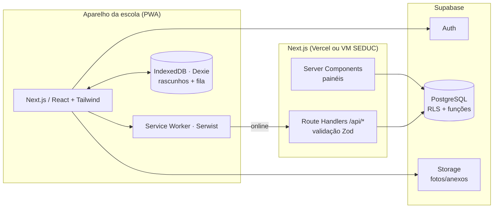
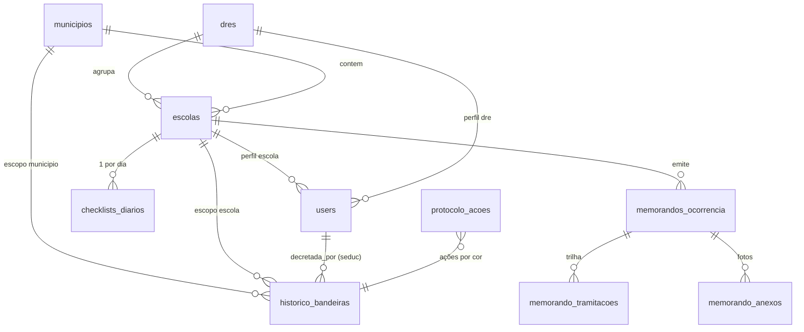
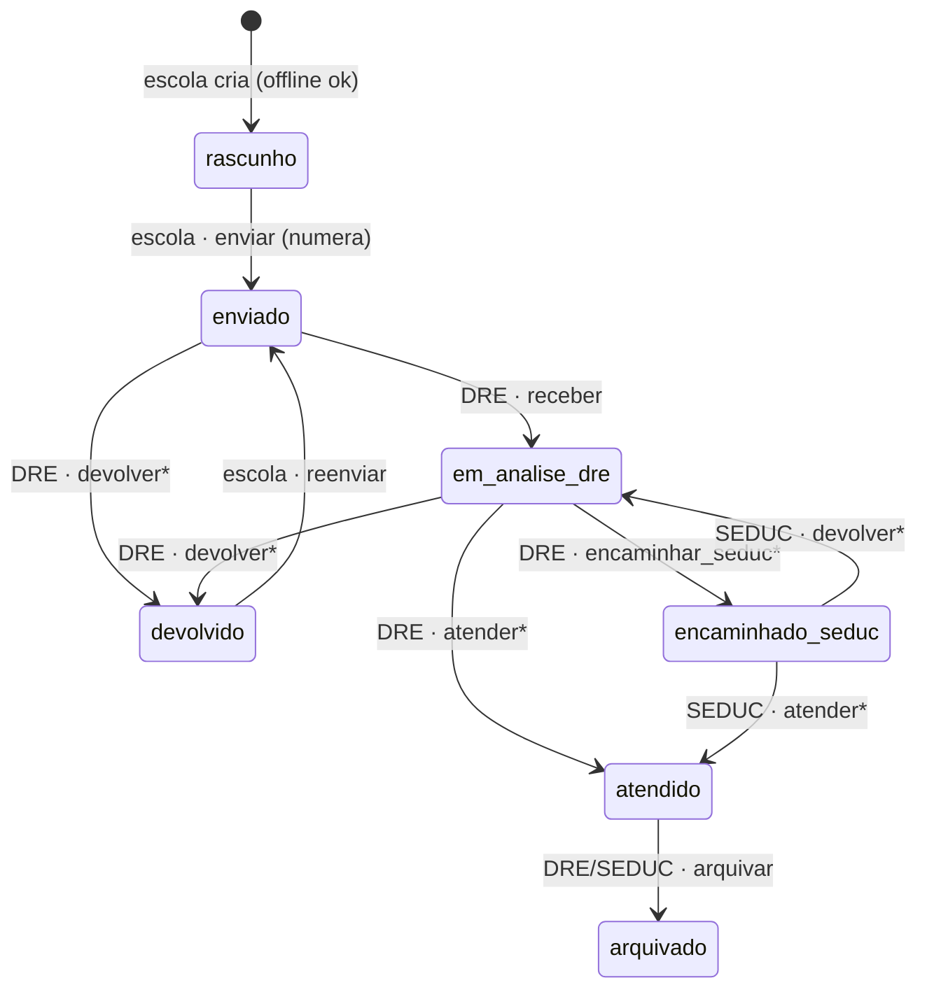

# Vigília Escolar PA

Sistema web/PWA para operacionalizar o **Protocolo de Gestão e Resposta aos Efeitos do El Niño nas Escolas Públicas Estaduais do Pará (SEDUC/PA 2026-2027)**: monitoramento de riscos climáticos (queimadas/fumaça, calor extremo, estiagem), sistema de bandeiras e tramitação formal de ocorrências (Memorando do Anexo I) entre Escola → DRE → SEDUC.

---

## 1. Arquitetura



| Camada | Escolha | Por quê |
|---|---|---|
| Front | **Next.js 15 (App Router) + React 19 + Tailwind 4** | SSR para o painel abrir rápido em 3G; um único repositório para UI e API. |
| Offline | **PWA (Serwist) + IndexedDB (Dexie)** | Escolas ribeirinhas/rurais perdem sinal. Leituras usam cache *NetworkFirst*; escritas entram numa **fila (outbox)** reenviada ao reconectar. |
| Banco | **PostgreSQL no Supabase** | Três níveis hierárquicos com visibilidade diferente pedem **RLS**; Auth, Storage e backups inclusos. SQLite local foi descartado como banco principal porque não resolve a sincronização entre escola, DRE e SEDUC — o papel de “banco local” fica com o IndexedDB. |
| Validação | **Zod** (compartilhado cliente/servidor) | O mesmo schema valida o formulário offline e a API. |

### Princípios
1. **O banco é a autoridade.** Quem pode decretar bandeira, quem vê qual memorando e quais transições de status são válidas é decidido no Postgres (RLS, `CHECK`, funções `SECURITY DEFINER`). A API e a UI apenas espelham — nenhuma brecha no front compromete o fluxo oficial.
2. **Idempotência offline.** IDs (memorando, checklist) são UUIDs gerados no aparelho. Reenviar a fila nunca duplica registros.
3. **Trilha de auditoria imutável.** `historico_bandeiras` e `memorando_tramitacoes` são *append-only*; decretar uma nova bandeira encerra a anterior automaticamente.
4. **Rascunho não consome número.** O número oficial (`MEMO-<INEP>-<ANO>-<SEQ>`) só é atribuído no despacho, em transação, sem buracos na sequência.

---

## 2. Banco de dados

Arquivos: `supabase/migrations/*.sql` e `supabase/seed.sql`.



| Tabela | Papel |
|---|---|
| `users` | Perfil de aplicação ligado a `auth.users`. `CHECK` garante: perfil `escola` ⇒ `escola_id`; `dre` ⇒ `dre_id`; `seduc` ⇒ nenhum vínculo. |
| `escolas`, `dres`, `municipios` | Estrutura territorial. Escola tem flag `risco_isolamento` (acesso fluvial/vicinal). |
| `historico_bandeiras` | Decretos da SEDUC por **município** ou **escola**. Índice único parcial impede duas bandeiras abertas no mesmo alvo. `CHECK` impede regime não presencial/CEMEP fora da vermelha. |
| `vw_bandeira_vigente` | Bandeira efetiva por escola: decreto da escola **prevalece** sobre o do município; sem decreto ⇒ verde. |
| `protocolo_acoes` | Catálogo de ações por cor (**cumulativas**). A SEDUC ajusta o protocolo sem deploy. |
| `checklists_diarios` | Água, reservatório %, temperatura, fumaça, acesso, sintomas e ações marcadas. Único por escola/dia (upsert). Guarda *snapshot* da bandeira. |
| `memorandos_ocorrencia` | **Anexo I**: tipos de ameaça (`fumaca_queimadas`, `estiagem_agua`, `outros` + descrição), descrição, impactos pedagógicos, impactos operacionais, providências tomadas, apoio necessário da DRE, alunos afetados, aulas suspensas, prioridade. `CHECK` exige o formulário completo fora do rascunho. |
| `memorando_tramitacoes` | Trilha de cada mudança de status com parecer, ator e perfil. |
| `memorando_transicoes` | Máquina de estados em tabela (fonte única). |

### Visibilidade (RLS)
| | Escola | DRE | SEDUC |
|---|---|---|---|
| Bandeiras | lê todas | lê todas | **decreta** e lê |
| Checklists | escreve/lê os seus | lê o polo | lê todos |
| Memorandos | escreve (rascunho/devolvido) e lê os seus | lê o polo **sem rascunhos**, tramita | lê todos sem rascunhos, tramita os encaminhados |

Colunas `status`, `numero`, `escola_id`, `dre_id` **não têm GRANT de escrita**: só mudam via `enviar_memorando()` / `tramitar_memorando()`.

---

## 3. Fluxo do Memorando do Anexo I


\* exige parecer.

### API

| Método | Rota | Quem | Descrição |
|---|---|---|---|
| `GET` | `/api/memorandos?status=&escola=&cursor=` | todos | Lista (recorte por RLS), paginação por cursor. |
| `POST` | `/api/memorandos` | escola | Cria rascunho. **Idempotente** pelo `id` (201 novo / 200 já existia). |
| `GET` | `/api/memorandos/:id` | todos | Memorando + tramitações + anexos. |
| `PATCH` | `/api/memorandos/:id` | escola | Edita rascunho/devolvido. `base_updated_at` ⇒ 409 se alterado em outro aparelho. |
| `DELETE` | `/api/memorandos/:id` | escola | Descarta rascunho. |
| `POST` | `/api/memorandos/:id/enviar` | escola | Despacho: valida Anexo I, numera, registra tramitação. 422 lista `campos` faltantes. |
| `POST` | `/api/memorandos/:id/tramitar` | DRE/SEDUC | `{ acao, parecer? }`. 409 se a transição não é válida. |
| `GET` | `/api/escola/painel` | escola | Snapshot do dashboard (cacheado p/ offline). |
| `PUT`/`PATCH` | `/api/escola/checklist` | escola | Upsert do checklist do dia / marcar ações. |

Erros padronizados: `{ "erro": { "codigo", "mensagem", "campos?" } }`. SQLSTATE → HTTP em `src/lib/http/respostas.ts` (`42501`→403, `P0002`→404, `55000`→409, `23514`→422).

**Reporte imediato offline:** `reportarOcorrencia()` (em `src/lib/offline/fila.ts`) grava o rascunho local e enfileira `POST /api/memorandos` + `POST /enviar`. A fila respeita ordem por memorando, faz *backoff* (5 s → 5 min) em falha de rede e marca como `requer_atencao` erros de negócio (ex.: campo faltando).

---

## 4. Estrutura de pastas

```
vigilia-escolar-pa/
├── supabase/
│   ├── migrations/
│   │   ├── 20261111000001_schema_inicial.sql      # tipos, tabelas, índices, CHECKs
│   │   └── 20261111000002_regras_rls_funcoes.sql  # helpers, view, triggers, funções, RLS
│   └── seed.sql                                    # ações do protocolo + dados fictícios
├── src/
│   ├── app/
│   │   ├── (escola)/escola/page.tsx               # Dashboard da Escola (RSC)
│   │   ├── (dev)/preview/escola/page.tsx          # Preview com dados fictícios (?cor=)
│   │   ├── api/
│   │   │   ├── memorandos/route.ts                # GET lista · POST rascunho
│   │   │   ├── memorandos/[id]/route.ts           # GET · PATCH · DELETE
│   │   │   ├── memorandos/[id]/enviar/route.ts    # despacho escola → DRE
│   │   │   ├── memorandos/[id]/tramitar/route.ts  # DRE / SEDUC
│   │   │   └── escola/{painel,checklist}/route.ts
│   │   ├── sw.ts · manifest.ts · offline/          # PWA
│   │   └── layout.tsx · globals.css
│   ├── components/escola/                          # BandeiraBanner, AcoesObrigatorias,
│   │                                               # IndicadoresDia, OcorrenciasRecentes,
│   │                                               # ReporteRapido, DashboardEscola
│   ├── modules/                                    # domínio, sem dependência de UI
│   │   ├── ocorrencias/{schema,maquina-estados,repositorio}.ts
│   │   ├── bandeiras/protocolo.ts
│   │   └── escola/painel.ts
│   ├── lib/{supabase,http,offline}/
│   └── types/dominio.ts
└── next.config.ts · package.json · tsconfig.json
```

Próximos módulos seguem o mesmo padrão: `src/modules/dre` (fila de triagem por prioridade), `src/modules/seduc` (decretação em lote por município, painel estadual), `app/(dre)/dre`, `app/(seduc)/seduc`.

---

## 5. Como rodar

```bash
npm install
supabase start && supabase db reset     # aplica migrations + seed
cp .env.example .env.local              # preencha URL/anon key do `supabase status`
npm run dev                             # http://localhost:3000/preview/escola?cor=vermelha
```

## 6. Verificações feitas
- Migrations + seed aplicadas em PostgreSQL 16 (PGlite) com stub do schema `auth`, e um roteiro de 24 verificações (`npm run db:test`) cobrindo RLS por perfil, numeração, validação do Anexo I, máquina de estados, precedência de bandeiras, snapshot e upsert do checklist — todos passando.
- `tsc --noEmit` e `next build` sem erros.

## 7. Premissas a validar com a SEDUC
- Os campos do Anexo I foram modelados a partir da descrição do protocolo (tipo de ameaça, impactos pedagógicos/operacionais, providências, apoio da DRE). Conferir contra o modelo oficial do memorando e incluir campos que faltarem (ex.: assinatura/cargo do responsável).
- Redação das ações em `seed.sql` deve ser substituída pelo texto oficial do protocolo.
- Regra de precedência “decreto da escola prevalece sobre o do município” (inclusive para rebaixar).
- Formato do número do memorando e uso do fuso `America/Belem`.
